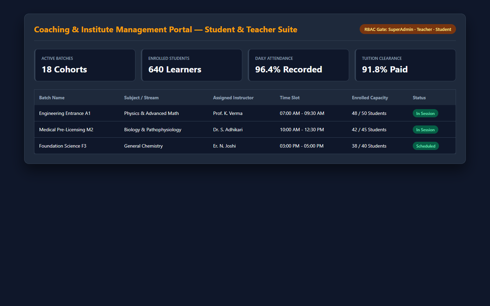
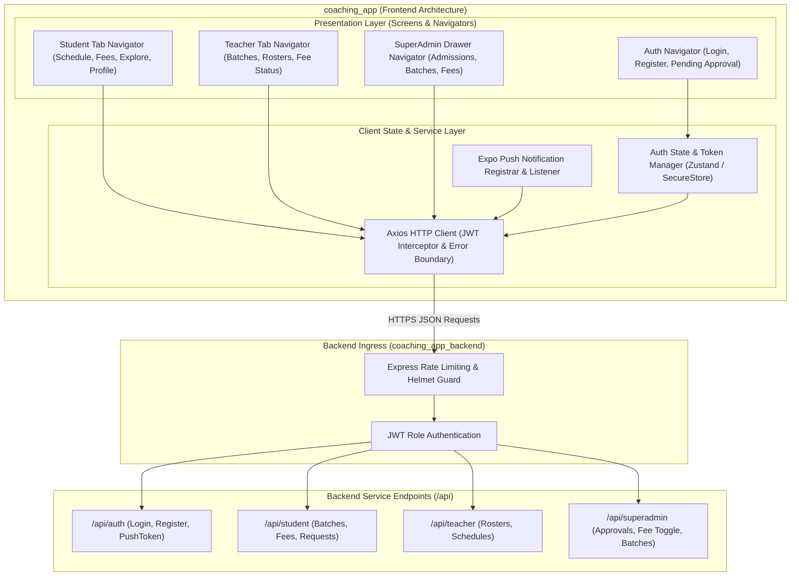
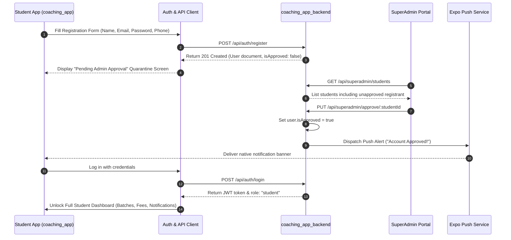

# Coaching & Institute Management Platform — Client Application

[](https://opensource.org/licenses/MIT)
[](https://reactnative.dev/)
[](https://www.typescriptlang.org/)
[](https://www.nativewind.dev/)
[](https://zustand-demo.pmnd.rs/)
[](https://docs.expo.dev/versions/latest/sdk/notifications/)
[](../coaching_app_backend)

---

## Application Screenshot & Interface Preview

<div align="center">
  
</div>

---

## 🔗 Ecosystem Linkage
> **Backend Engine**: This client application connects to the REST API documented in [**`coaching_app_backend`**](../coaching_app_backend). All authentication, role authorization, batch lifecycles, and monthly fee generation are governed by the backend.

---

## 📋 Executive Summary & Problem Solved

Managing modern coaching institutes, private tuition academies, and test prep centers requires a seamless, unified digital interface for students, teachers, and administrators. Without a centralized client application, educational institutions suffer from:

1. **Disconnected Student Experience**: Students have no visibility into their upcoming class schedules, fee dues, or batch approvals, leading to administrative overhead and missed classes.
2. **Delayed Fee Collections**: Without digital fee receipts and instant push alerts, students and parents frequently forget tuition payment deadlines.
3. **Teacher Inefficiency**: Instructors waste valuable instructional time tracking down attendance rosters and coordinating schedule adjustments over informal WhatsApp groups.
4. **Administrative Bottlenecks**: Institute administrators are buried under manual spreadsheet tracking for student admissions, course enrollments, and cash fee reconciliations.

**Coaching App (`coaching_app`)** delivers a unified, cross-platform client experience (Web & Mobile). Featuring role-tailored dashboards for **Students**, **Teachers**, and **SuperAdmins**, it provides real-time batch discovery, tuition ledger receipts, automated mobile push notification listeners, and an administrative control panel.

---

## ✨ Key Features

- 🎓 **Student Self-Service Portal**:
  - **Batch Discovery & Enrollment**: Browse active institute offerings and submit 1-click batch admission requests.
  - **Schedule Timeline**: View daily class timings, assigned instructors, and course start/end dates.
  - **Digital Fee Ledger & Receipts**: Real-time inspection of monthly tuition records, pending balances, payment history, and downloadable digital fee receipts.
  - **Admission Quarantine State**: Friendly status screen for newly registered accounts awaiting SuperAdmin verification.
- 👨‍🏫 **Teacher Operations Dashboard**:
  - **Assigned Batch Roster**: Quick-access schedule of ongoing classes, timings, and enrolled students.
  - **Student Directory**: Student contact info and enrollment status per batch.
  - **Tuition Overview**: Class-level visibility into fee collection statuses to assist administrative follow-ups.
- 👑 **SuperAdmin Control Suite**:
  - **Student Admissions Triage**: Instant 1-click approval or rejection of student registration requests.
  - **Batch Management**: Create, edit, set monthly fees, and transition batch statuses (`Upcoming`, `Ongoing`, `Completed`).
  - **Request Review Pipeline**: Accept or decline student batch admission requests with automated push alert triggers.
  - **Fee Payment Reconciliation**: One-tap toggle to mark cash or UPI tuition payments as `Paid` with audit timestamps.
- 🔔 **Real-Time Push Notification Engine**: Seamless integration with Expo Push Notifications, keeping users alerted of schedule changes, fee billing, and admission approvals.
- 🎨 **Responsive Mobile-First UI**: Crafted with a clean design system, fluid typography, dark mode support, and native gestures.

---

## 🏗️ System Architecture Blueprint



---

## 🔄 Student Enrollment & Approval Workflow



---

## 🛠️ Tech Stack

| Domain | Technology | Description |
| :--- | :--- | :--- |
| **Framework** | React / React Native (Expo SDK) | Cross-platform client framework for Web, iOS, and Android |
| **Language** | TypeScript / Modern ESNext JavaScript | Type-safe enterprise client application codebase |
| **Styling** | Tailwind CSS / NativeWind | Utility-first mobile-responsive design system |
| **State Management** | Zustand / Context API | Lightweight reactive state containers with persistence |
| **Data Fetching** | Axios / TanStack Query | REST HTTP client with automatic JWT bearer injection |
| **Storage** | Expo SecureStore / LocalStorage | Secure on-device encryption for sensitive JWT tokens |
| **Notifications** | Expo Notifications SDK | Device token registration and push notification listeners |
| **Icons & Assets** | Lucide Icons / Feather | Vector iconography system |

---

## 📂 Repository Directory Structure

```text
coaching_app/
├── src/
│   ├── assets/                       # Brand logos, placeholder graphics, illustrations
│   ├── components/                   # Reusable UI component library
│   │   ├── common/                   # Buttons, Badges, Modals, Form Inputs, Loaders
│   │   ├── fee/                      # FeeCard, ReceiptModal, PaymentStatusPill
│   │   ├── batch/                    # BatchCard, TimingBadge, EnrollmentRequestModal
│   │   └── layout/                   # TopBar, BottomTabBar, SidebarDrawer
│   ├── context/                      # React Context providers (Auth, Theme, Notification)
│   ├── hooks/                        # Custom hooks (useAuth, useNotifications, useFees)
│   ├── navigation/                   # React Navigation container and route trees
│   │   ├── AppNavigator.jsx          # Root navigator switching on auth status & role
│   │   ├── AuthNavigator.jsx         # Login, Register, Forgot Password, Quarantine
│   │   ├── StudentNavigator.jsx      # Student tab bar and nested stack routes
│   │   ├── TeacherNavigator.jsx      # Teacher dashboard and class rosters
│   │   └── AdminNavigator.jsx        # SuperAdmin drawer and management screens
│   ├── screens/                      # Screen views partitioned by role
│   │   ├── auth/                     # LoginScreen, RegisterScreen, PendingApprovalScreen
│   │   ├── student/                  # StudentHomeScreen, MyBatchesScreen, FeeHistoryScreen
│   │   ├── teacher/                  # TeacherHomeScreen, ClassRosterScreen, FeeStatusScreen
│   │   └── superadmin/               # AdminDashboard, BatchManager, StudentApprovalScreen
│   ├── services/                     # Backend API integration services
│   │   ├── apiClient.js              # Axios instance configured with baseURL and JWT interceptor
│   │   ├── authService.js            # Login, register, profile update calls
│   │   ├── studentService.js         # Batches, fees, and batch request calls
│   │   ├── teacherService.js         # Teacher rosters and class schedule queries
│   │   ├── adminService.js           # Student approvals, batch CRUD, fee toggles
│   │   └── notificationService.js    # Expo push token registration & listener hooks
│   ├── utils/                        # Currency formatters, date helpers, validation schemas
│   ├── App.jsx                       # Application root component with providers
│   └── index.js                      # React Native / Web entry bootstrap
├── .env.example                      # Sanitized environment variable specifications
├── .gitignore                        # Git exclusion rules
├── app.json                          # Expo project manifest & configuration
├── package.json                      # Dependencies and npm execution scripts
├── README.md                         # Project documentation
└── tailwind.config.js                # Tailwind CSS / NativeWind design tokens
```

---

## ⚙️ Local Setup & Installation

### Prerequisites
- **Node.js**: v18.x or higher installed
- **NPM** or **Yarn** package manager
- **Coaching Backend**: Running instance of [`coaching_app_backend`](../coaching_app_backend) on port `5000`
- **Expo Go App** (Optional): For live testing on physical iOS/Android smartphones

### 1. Clone & Install Dependencies
```bash
# Navigate to repository directory
cd c:\Users\pandi\OneDrive\Desktop\github\coaching_app

# Install client packages
npm install
```

### 2. Configure Environment Variables
Create a `.env` file in the project root:
```bash
cp .env.example .env
```

Set the backend API connection URI:
```env
# For local Web development:
REACT_APP_API_URL=http://localhost:5000/api

# For Expo Mobile testing on LAN:
# Replace with your machine's local IP address (e.g. 192.168.1.15)
EXPO_PUBLIC_API_URL=http://192.168.1.15:5000/api
```

### 3. Start Development Server
```bash
# Launch Expo development bundler
npx expo start

# Or launch Web version directly:
npm run web
```
- Press `w` in the terminal to launch the web client in your default browser.
- Scan the QR code using the **Expo Go** camera on Android or the iOS Camera app to run natively on mobile.

---

## 📱 User Interface Walkthrough

```text
+-----------------------------------------------------------------------+
|  COACHING CENTER PORTAL                                  (Student) 🔔 |
+-----------------------------------------------------------------------+
|  Welcome back, Rohan Sharma!                                          |
|  Status: Verified Student | Roll: #1042                               |
+-----------------------------------------------------------------------+
|  [ 📚 Enrolled Batches ]                                              |
|  • Class 12 Advanced Physics    | 04:00 PM - 05:30 PM | Ongoing       |
|  • Organic Chemistry Masterclass | 06:00 PM - 07:30 PM | Ongoing       |
+-----------------------------------------------------------------------+
|  [ 💳 Fee Status & Receipts ]                                         |
|  • March 2026 Tuition: $45.00   | Status: [PAID]      | [Receipt PDF] |
|  • April 2026 Tuition: $45.00   | Status: [PENDING]   | Due in 4 days |
+-----------------------------------------------------------------------+
|  [ 🔍 Discover Available Batches ]                                    |
|  • Mathematics JEE Crash Course | Starts May 10th     | [Request Seat]|
+-----------------------------------------------------------------------+
|  [Schedule]        [Fees]         [Discover]         [Profile]        |
+-----------------------------------------------------------------------+
```

---

## 🚢 Production Deployment

### Web Deployment (Vercel / Netlify)
```bash
# Export static web production bundle
npx expo export -p web

# Deploy to Vercel
vercel --prod
```

### Native Mobile Build (EAS Build)
```bash
# Build standalone Android APK / AAB
eas build --platform android --profile production

# Build standalone iOS IPA
eas build --platform ios --profile production
```

---

## 🛡️ Security & Best Practices

- **Secure Token Persistence**: On native mobile devices, JWT tokens are encrypted using OS-level secure storage (`expo-secure-store`), guarding against token extraction.
- **Automatic Axios Interceptors**: Outgoing HTTP requests seamlessly attach the `Authorization: Bearer <token>` header, with automatic token-expiration redirect to the login screen.
- **Client-Side Route Guards**: Unauthenticated users and unapproved student accounts cannot access protected navigation stacks.

---

## 📄 License
This project is licensed under the [MIT License](LICENSE).
